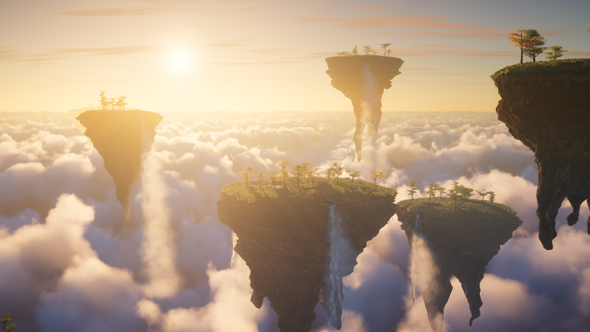

# Sky Islands

Floating islands above a sea of clouds at sunset, in one HTML file. Everything except three.js
(loaded from a CDN) is generated in code at load: no images, textures, models or audio files.

**Live: https://starknightt.github.io/sky-islands/**



## Run it locally

Open `index.html` in a recent Chrome, Edge or Firefox. It needs an internet connection the first
time, for three.js. If your browser blocks module scripts on `file://`, serve the folder instead:

```powershell
python -m http.server 8000
```

then open http://localhost:8000.

## Controls

You are the camera. There is no vehicle.

- Click to start. The mouse locks to the view and sound starts on that click.
- Mouse looks around. Esc releases the mouse; click again to take it back.
- W / S speed up and slow down. A / D strafe. Space rises, Shift descends.
- Movement has inertia on purpose: it eases in and out rather than snapping.

## URL options

- `?q=0` … `?q=3` pins the quality tier (3 is the default on a discrete GPU). Without it the page
  starts lower on integrated GPUs and steps down by itself if frames take too long.
- `?debug` logs the GPU renderer string.
- `?demo` plays the trailer used for `recording.mp4`.

## What is in the file

- Sky: single-scattering atmosphere with ozone, baked once into a lookup table; the sun colour,
  haze colour and ambient light all come from it.
- Clouds: raymarched volume over a drifting height field, self-shadowed, shadowed by the islands,
  temporally reprojected.
- Islands: procedural meshes. The rim is a soil profile (turf, dark topsoil, paler subsoil with
  stones, rubble, then bedded rock) with an undercut lip, hanging roots and rootlets, moss and wet
  rock beside the falls.
- Water: each stream runs from a pond down a meandering channel to a rock sill. Stream and falling
  sheet are one surface with one pattern, keyed to where and when each parcel of water crosses the
  lip: glassy and refractive on top, tearing into ropes, veils and droplets as it falls (gravity,
  drag and wind in closed form), with spray and mist that drift downwind.
- Grass: about 950k blades across the islands plus a ring of 300k three-blade tufts that follows
  the camera, with seed stalks, flowers, broadleaf plants and dead blades; colour, height and
  density follow shared ground fields, and gusts cross the meadow in bands.
- Also: about 70 trees, one cottage with lit windows and chimney smoke, 64 boids, and wind,
  waterfall and birdsong synthesized with Web Audio.

## Files

- `index.html` — the whole thing.
- `recording.mp4` — 59 s, 1920×1080, 60 fps trailer with sound: islands above the clouds, a
  waterfall lip up close, the fall from top to mist, a low glide over the grass, the cottage, a
  pass between two islands, and a pull-back.
- `thumbnail.png` — one frame. `og.jpg` — the social preview image (1280×640).
- `notes.md` — the reference studies and what was fixed in each art-direction round.

Note on the recording: it was rendered frame by frame from the page's `?demo` mode, and the
soundtrack was rendered by the same synth code through an `OfflineAudioContext`. In the live page
sound can only start on your first click; in the video it fades in from the first frame.

## Support

<p>
  <a href="https://buymeacoffee.com/prasenx"></a>&nbsp;&nbsp;
  <a href="https://github.com/sponsors/StarKnightt"></a>
</p>
